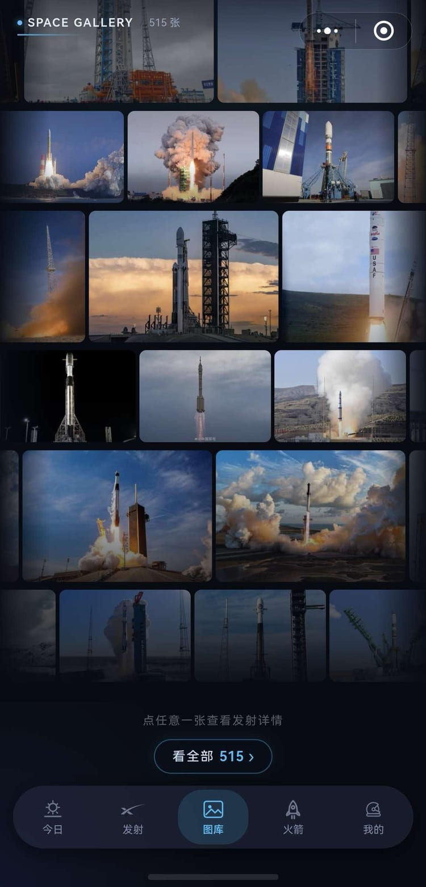
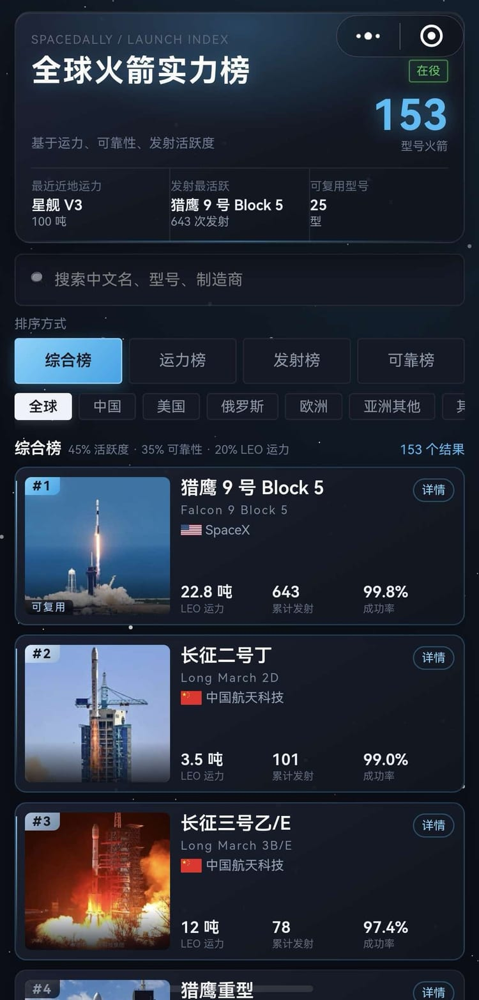

# SpaceLaunch 小程序

航天发射跟踪类微信小程序：发射日历、航天资讯、图库、火箭与航天器百科、太空资产。


## 功能

| tab | 内容 |
|---|---|
| 今日 | 每日一图 / 天文 / 地球三卡轮播、在轨航天员、当前任务、往年今日 |
| 发射 | 倒计时、即将发射与已发射、搜索筛选 |
| 图库 | 漂流图墙；发射图片 / 视频 / 地球 / 天文 / 星云分类，另设 NASA 影像入口 |
| 火箭 | 型号库、综合榜（贝叶斯收缩 × 对数活跃度） |
| 我的 | 收藏、统计、版本记录 |

详情覆盖发射、火箭、机构、工位、航天员、空间站、远征队、太空资产（在轨 / 卫星目录 /
解体）、近地天体、资讯、活动；全局搜索覆盖发射、火箭、航天员、工位、机构。

## 截图

<p>



</p>

## 架构

```
GitHub Actions                         COS + CDN
├─ sync      15 分钟 ~ 每小时   →   space-data/*.json
├─ archive   每小时 4 次        →   history/pNN.json
├─ news      每 3 小时         →   news.json
├─ nasa-daily 每天             →   apod.json / epic.json
├─ neo       每天              →   neo-nears.json
└─ gcat / nasa-images 每月 1 号 →   satellites*.json / nasa-images.json
                                        ↓
                                小程序：内存 → Storage → CDN 三级缓存
```

大集合分片传输（卫星目录两万余条，按 `chunks` 切片，触底增量拉取）。

## 目录

| 路径 | 说明 |
|---|---|
| `pages/` | 30 个页面 |
| `components/` | 卡片、倒计时、导航条、筛选抽屉、各板块 section |
| `custom-tab-bar/` | 悬浮胶囊 tabBar（原生 wxml/wxss/js，非 .vue） |
| `utils/` | 数据层、格式化、搜索匹配、收藏、分享 |
| `scripts/` | 抓取生成脚本 + `lib/` + 校验脚本 |
| `.github/workflows/` | 11 条流水线（9 定时 + 2 手动） |
| `dist/` | 生成的 JSON 快照（不入库） |

## 署名

GCAT 数据来自 Jonathan McDowell（CC-BY），署名见对应页面与「我的 → 关于」；影像来自
NASA，版权归 NASA 及各作者；发射基础数据来自 The Space Devs。仅供学习，不保证数据准确。
